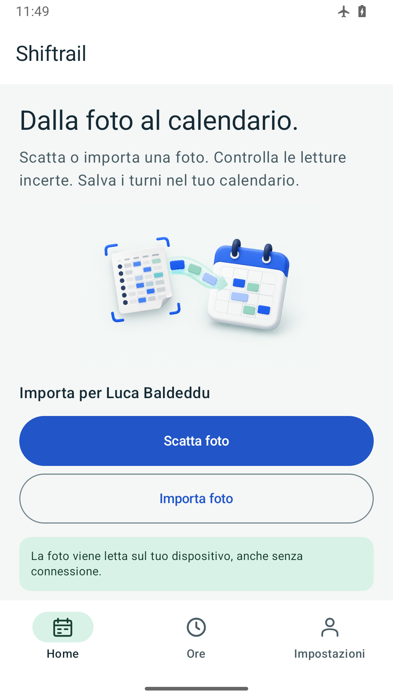
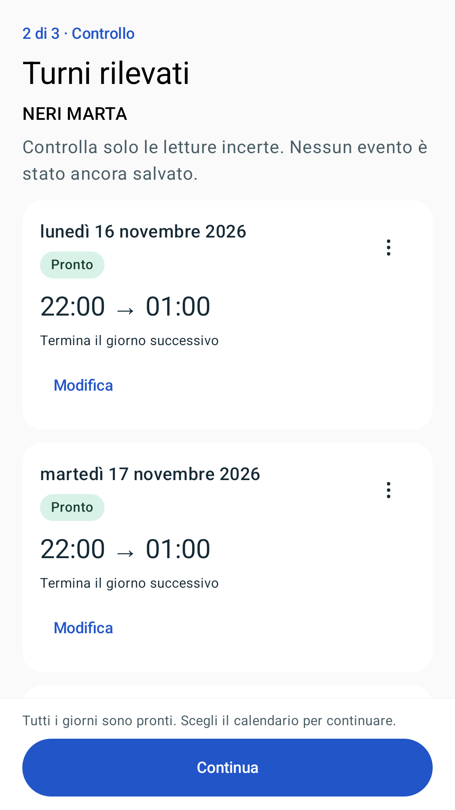
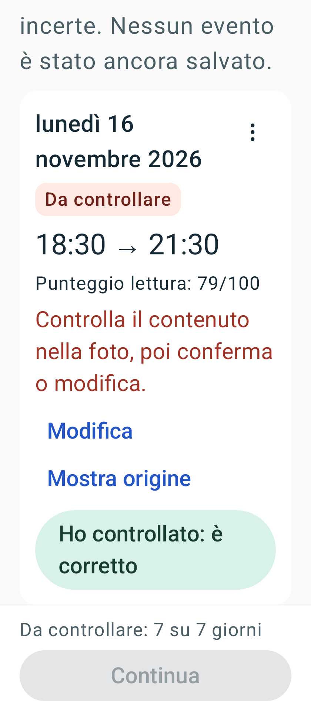

# Shiftrail

App Android nativa che legge la tua riga da una foto del tabellone settimanale e prepara eventi nel calendario del dispositivo. Le letture con punteggio almeno 90/100 proseguono senza conferma individuale; quelle incerte richiedono controllo. Il modello OCR latino è incluso nell’APK; foto e testo OCR vengono elaborati localmente.

Android 8.0 o successivo, Kotlin, Compose Material 3, CameraX, ML Kit, Room, coroutine, ViewModel/StateFlow e Navigation Compose. Nessun account dell’app, backend o API AI a pagamento.

## Download e release

[Scarica l’ultima versione](https://github.com/GoryNickel9/app-turni/releases/latest) · [Tutte le release](https://github.com/GoryNickel9/app-turni/releases)

Installa l’APK come aggiornamento senza disinstallare l’app, per mantenere i dati. Dalla versione 0.3.0 Shiftrail controlla automaticamente le nuove release una volta al giorno; il controllo manuale è in **Impostazioni → Aggiornamenti**. Download e installazione richiedono la tua scelta. Protocollo, firma e pubblicazione sono descritti in [aggiornamenti](docs/UPDATES.md).

  

## Utilizzo

1. Apri **Impostazioni** e inserisci **Nome e cognome** come appaiono sul tabellone. Scegli il preavviso (inizialmente 30 minuti), i colori di lavoro e riposo e se salvare le X.
2. Scatta una foto o scegli un’immagine con il Photo Picker. Trascina i quattro angoli del crop mantenendo visibili nome, giorni e date.
3. Controlla la riga scelta e le date. Se il nome è ambiguo, seleziona la riga; se l’anno manca, conferma la data del lunedì.
4. Correggi, elimina o aggiungi celle. Usa **Mostra origine** per confrontare il contenuto. Sotto 90/100 occorre una verifica esplicita; da 90/100 incluso non compare una conferma individuale. Le celle non riconosciute richiedono correzione o eliminazione.
5. Scegli **Google Calendar**, che identifica esclusivamente il calendario PC Sync del dispositivo, e verifica il piano di sincronizzazione. Le nuove celle sono preselezionate; aggiornamenti ed eliminazioni richiedono una scelta.

`19-01` produce un evento **Lavoro** dalle 19:00 alle 01:00 del giorno seguente. `X` è l’unica lettera ammessa e, se abilitata nelle impostazioni, produce un evento di intera giornata intitolato **Giorno di riposo**. Altre lettere richiedono correzione. Numeri isolati come `6` non diventano turni.

**Ore** mostra il totale di un mese o di una sua settimana, distinguendo i turni salvati dal lavoro extra. Ogni turno mostra inizio e fine modificabili: salvare un turno importato aggiorna anche l’evento nel calendario e ricalcola le ore. L’extra si inserisce con data, inizio e fine; può essere modificato o eliminato e resta locale a Shiftrail. I turni notturni sono suddivisi a mezzanotte quando attraversano il confine del periodo. Le ore importate derivano dal programma salvato, non da una rilevazione delle presenze. Vedi [conteggio ore](docs/WORKING_HOURS.md).

## Build

Richiede JDK 17 o 21, Android SDK 35 e build-tools 35.0.0. Apri il repository in Android Studio oppure configura `ANDROID_HOME` / `local.properties` con `sdk.dir`.

```sh
./gradlew assembleDebug
./gradlew test
./gradlew lint
./gradlew checkKotlinFormat
```

Su Windows usa `gradlew.bat`. L’APK è `app/build/outputs/apk/debug/app-debug.apk`. Per installarlo su un dispositivo con debug USB: `./gradlew installDebug`.

In questo ambiente Windows Java restituisce `Unable to establish loopback connection` sulle socket AF_UNIX. `scripts/verify-windows.ps1 -Jdk "C:\Program Files\Java\jdk-21"` applica un workaround soltanto ai processi figli, esegue build/test/lint e ripristina le variabili d’ambiente. Non serve su un ambiente sano.

L’APK distribuito su GitHub è prodotto da `assembleRelease`, è non debuggabile e mantiene il certificato delle versioni precedenti per consentire l’aggiornamento delle installazioni esistenti. La chiave privata rimane locale. `scripts/publish-release.ps1` verifica l’impronta prima della pubblicazione; i build debug della CI servono ai test. Dettagli in [UPDATES.md](docs/UPDATES.md).

## Architettura e test

`core/` è Kotlin JVM: modelli OCR normalizzati, parser geometrico, matching nomi, parser date/orari, factory degli eventi, confronti e chiavi stabili. Non dipende da Android. `app/` contiene adattatori ML Kit, immagini, Room, CalendarContract e schermate Compose. Il parser accetta token sintetici senza avviare OCR.

La CI esegue build debug, test JVM e lint. I test strumentati richiedono un dispositivo o emulatore:

```sh
./gradlew connectedDebugAndroidTest
```

`testdata/synthetic-roster.png` usa dipendenti fittizi e verifica il flusso OCR. Configura `Luca Baldeddu` per provarlo. I test verificano anche la versione ridotta e un altro tabellone con layout, dipendente, settimana e turni diversi. Le sigle diverse da `X` presenti nelle fixture verificano il rifiuto delle lettere non ammesse.

La versione 0.1.1 rilegge i tabelloni fitti tramite ritagli sovrapposti ingranditi, riconosce intestazioni inclinate e cerca le date sopra la prima riga dei dipendenti. Le letture discordanti degli orari diventano celle da correggere: **Mostra origine** consente il confronto con la foto e **Modifica** inserisce il valore corretto. Nomi, coordinate e orari delle foto segnalate non sono incorporati nel codice dell’app.

La versione 0.1.2 recupera anche orari frammentati dall’OCR o uniti a contatori numerici. Queste celle richiedono **Ho verificato questa cella** dopo il controllo dell’origine; gli orari discordanti richiedono ancora modifica o eliminazione.

La versione 0.1.3 rilegge le celle usando i box del testo completo, con margini e ingrandimento adattati alla dimensione dei caratteri. Questo evita di tagliare cifre quando le intestazioni sono decentrate rispetto alle celle. Se la lettura resta illeggibile, prova più contesto; i contatori uniti alle cifre senza separatori possono ancora richiedere modifica manuale.

La versione 0.1.4 usa la grammatica degli orari per proporre il recupero di un carattere sospetto o di una cifra duplicata, mantenendo il limite di otto cifre e nessuna lettera nell’intervallo. Ogni proposta richiede verifica e mostra la lettura OCR originale. Il punteggio considera il segnale meno affidabile; confermare nome e date non aumenta la qualità attribuita alle cifre.

## Privacy e permessi

CAMERA serve soltanto alla cattura. Il Photo Picker non richiede accesso all’intera galleria. READ_CALENDAR e WRITE_CALENDAR sono richiesti quando si continua dalla revisione. Le catture temporanee vengono rimosse dopo la lettura e all’avvio successivo in caso di interruzione. L’immagine viene conservata in memoria durante la revisione; l’utente può salvarne una copia tramite il selettore Android.

Room conserva profilo, alias, legenda, impostazioni, fingerprint e associazioni dei turni sincronizzati. Le foto, il testo OCR degli altri dipendenti e i token non vengono salvati nel database. Backup Android disattivato. INTERNET serve al controllo e al download delle GitHub Releases; foto, testo OCR, profilo e calendari non vengono inviati all’updater. Il provider del calendario può sincronizzare gli eventi con Google o altri account secondo le impostazioni del dispositivo.

## Calendario e limiti

Una chiave stabile per dipendente/data/calendario e l’ID provider evitano i duplicati. Il marker nella descrizione permette di recuperare eventi dopo un’interruzione tra CalendarContract e Room. Gli aggiornamenti modificano l’evento esistente; le cancellazioni non vengono decise dal parser. Il batch provider è atomico; i due database non condividono una transazione.

Questa versione gestisce una cella e un evento per giorno. Più turni separati nello stesso giorno richiedono una revisione del modello. Gli orari che cadono in un intervallo DST inesistente o duplicato vengono rifiutati, con richiesta di correzione. Il crop prospettico è manuale; rilevamento automatico dei bordi e deskew automatico non sono implementati. La confidenza è un punteggio euristico, non una probabilità calibrata.

## Ricerca e attribution

È stato scelto un progetto nuovo, senza fork né copia di codice applicativo. La ricerca è documentata in [docs/OPEN_SOURCE_RESEARCH.md](docs/OPEN_SOURCE_RESEARCH.md). I [sample ML Kit](https://github.com/googlesamples/mlkit) (Apache-2.0) sono stati consultati come riferimento; [Calendar Provider](https://developer.android.com/identity/providers/calendar-provider) e [ML Kit Android](https://developers.google.com/ml-kit/vision/text-recognition/v2/android) definiscono le API usate. AndroidX e Kotlin sono Apache-2.0; ML Kit e le dipendenze Google sono distribuiti secondo i termini Google. Vedi [THIRD_PARTY_NOTICES.md](THIRD_PARTY_NOTICES.md).

Documentazione: [architettura](docs/ARCHITECTURE.md), [pipeline OCR](docs/OCR_PIPELINE.md), [parser](docs/SHIFT_PARSER.md), [sincronizzazione](docs/CALENDAR_SYNC.md), [report verifiche](docs/IMPLEMENTATION_REPORT.md).

La versione 0.2.0 introduce Shiftrail, l’immagine della home, la navigazione inferiore, il tema scuro e i pulsanti principali fissi. Identità e prompt dell’immagine sono in [BRANDING.md](docs/BRANDING.md); flusso e soglia sono in [UI_UX.md](docs/UI_UX.md).

La versione 0.2.1 elimina Storico e la schermata di diagnostica, limita Impostazioni al nome e cognome e interpreta soltanto `X` come Giorno di riposo. Gli eventi di riposo sono intera giornata; gli altri turni mantengono orari e identità. Le vecchie legende non influenzano più l’importazione. Dettagli e verifiche sono in [UI_RELEASE_0_2_1.md](docs/UI_RELEASE_0_2_1.md).

La versione 0.2.2 aggiunge Ore, extra manuali, preferenze del calendario e migrazione Room 1→2. PC Sync viene mostrato come Google Calendar; i turni si chiamano Lavoro. L’OCR rilegge anche gli intervalli validi con punteggio basso. La [schermata mensile](docs/images/shiftrail-hours-month.png) e la [settimana selezionata](docs/images/shiftrail-hours-week.png) usano dati sintetici. Risultati e limiti sono in [UI_RELEASE_0_2_2.md](docs/UI_RELEASE_0_2_2.md).

La versione 0.2.3 permette di modificare gli orari dei turni importati da Ore e aggiorna direttamente il calendario associato. Il salvataggio verifica l’accesso in scrittura tramite l’ID del calendario: non richiede che sia visibile o che conservi il nome PC Sync. I dettagli sono in [sincronizzazione calendario](docs/CALENDAR_SYNC.md).

La procedura di validazione e il benchmark sono descritti in [docs/VALIDATION.md](docs/VALIDATION.md). Le correzioni OCR sono documentate per [0.1.1](docs/OCR_FIX_0_1_1.md), [0.1.2](docs/OCR_FIX_0_1_2.md), [0.1.3](docs/OCR_FIX_0_1_3.md) e [0.1.4](docs/OCR_FIX_0_1_4.md).
