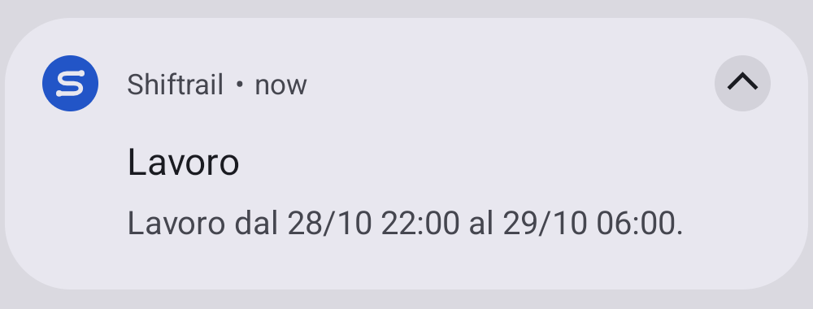
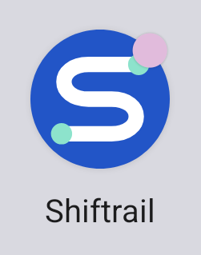

# Shiftrail

Nome scelto dall’utente il 7 ottobre 2026. Unisce «shift», turno, e «trail», percorso: dalla foto del tabellone agli eventi del calendario. Il nome visualizzato cambia; application ID, database e identità degli eventi restano compatibili con gli aggiornamenti precedenti.

Lo stile usa blu, verde menta, testo blu scuro e superfici chiare. La modalità scura segue Android. Dal 27 ottobre 2026 il nuovo simbolo vettoriale dell’app è una S a forma di percorso, con due estremi verde menta su fondo blu. Il nome Shiftrail è stato confermato dall’utente. Il simbolo resta separato dall’illustrazione raster della home.

## Icona e notifiche

L’icona è disegnata direttamente nei vettori Android del progetto; non usa una nuova immagine generativa o una libreria di icone esterna. `drawable/shiftrail_mark.xml` è il disegno a colori, `shiftrail_mark_monochrome.xml` è la variante per le icone a tema di Android 13+, e `ic_notification.xml` adatta la stessa silhouette alla barra di stato. `mipmap-anydpi/ic_launcher.xml` definisce l’icona adattiva con i tre livelli: il launcher sceglie la maschera. Il progetto richiede già Android 8.0, quindi non conserva un’icona legacy inutilizzata.

Il fondo è blu `#2255C7`, il tratto è bianco e gli estremi sono verde menta `#8DE3CC`. Il simbolo principale resta nella zona sicura delle icone adattive. La versione monocromatica conserva l’alpha della silhouette, così Android può applicare il colore scelto dall’utente.

Le notifiche abilitano il badge e usano il simbolo monocromatico. Nei launcher compatibili un pallino indica una notifica ancora attiva. È un’indicazione gestita da Android: espandere la tendina non equivale a leggere la notifica; il pallino scompare quando l’avviso viene aperto o rimosso. Colore e forma dipendono dal launcher e dalle impostazioni di sistema. Non viene disegnato un contatore permanente dentro l’icona dell’app.

`NotificationPreviewTest` usa il renderer Android per esportare l’icona e cattura barra di stato, notifica e launcher con un turno sintetico 22:00–06:00. Queste anteprime mostrano il layout effettivo dell’emulatore Android 15; altri dispositivi possono mostrare un aspetto diverso.

| Icona | Notifica Android | Notifica attiva sul launcher |
| --- | --- | --- |
|  |  |  |

Sono conservate anche le catture complete della [tendina](images/shiftrail-notification.png), della [barra di stato](images/shiftrail-status-unread.png) e del [launcher](images/shiftrail-launcher-unread.png). I dettagli sono estratti dalle catture native, senza ridisegnare la notifica o il pallino.

## Immagine

L’illustrazione è stata generata con lo strumento integrato `image_gen`, senza immagini di riferimento o foto degli utenti. Il file originale è copiato in `app/src/main/res/drawable-nodpi/shiftrail_hero.png`. La home decodifica una versione ridotta in sRGB su un thread di lavoro e la mostra quando è pronta. Il riconoscimento dei tabelloni continua a usare soltanto OCR locale.

Prompt finale:

```text
Use case: stylized-concept
Asset type: brand illustration for the home screen of Shiftrail, an Android app that turns a photo of a weekly work roster into calendar events.
Primary request: a clean, modern, polished illustration of a paper weekly roster becoming an organized calendar. A small roster sheet with neat anonymous rows sits behind a prominent rounded calendar tile, with a subtle camera scan bracket and a short flowing path of three rounded time blocks connecting them. Clear silhouette, generous breathing room, friendly but precise.
Style/medium: refined editorial 3D illustration, matte surfaces, restrained depth and soft shadows; no shiny plastic, no photorealism.
Composition/framing: landscape 3:2, centered compact composition, entire subject comfortably inside the central two-thirds, suitable for a small mobile home screen.
Color palette: deep ink navy #162A35, vivid blue #2864E8, pale mint #D9F2E8, white; uniform very light grey-green background #F4F7F6.
Constraints: no text, no letters, no digits, no watermark, no brands, no human figures, no phone mockup, no leaf motifs. The calendar grid should have simple colored event blocks instead of writing. Only one coherent illustration, not a presentation board.
```

## Ricerca del nome

La ricerca preliminare ha trovato prodotti esistenti per [ShiftSnap](https://www.shiftsnap.com.au/), [Shiftora](https://www.shiftora.io/en) e [Rosterly](https://play.google.com/store/apps/details?id=com.rosterly.mobile). Sono stati proposti Shiftleaf e Shiftrail; l’utente ha scelto Shiftrail. La ricerca riguarda la scelta del nome del progetto.
